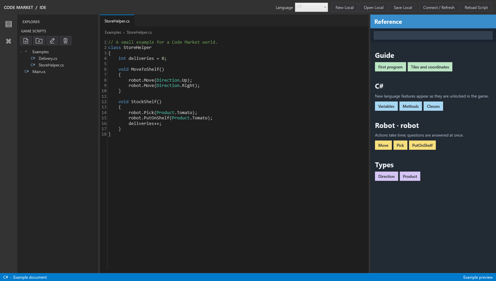
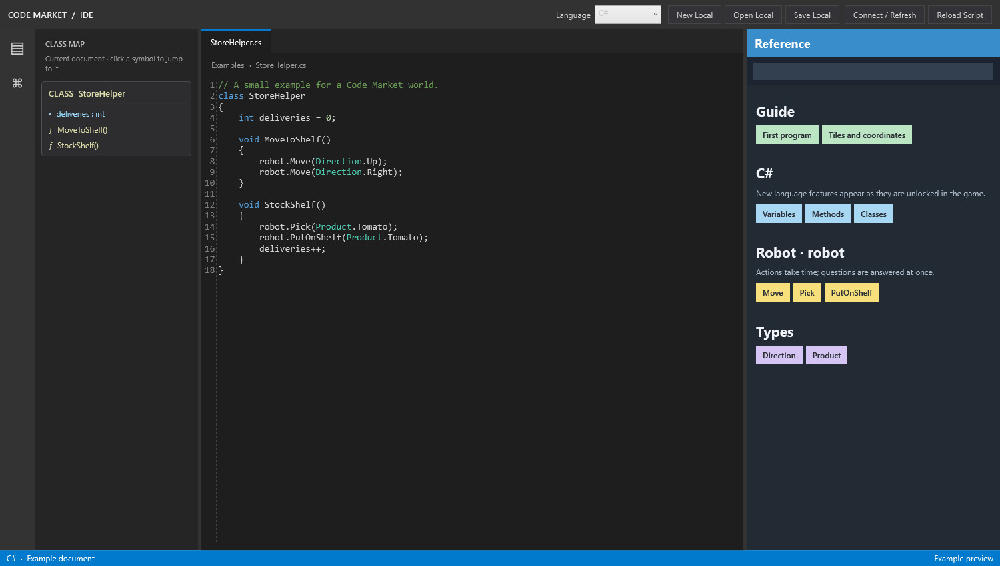
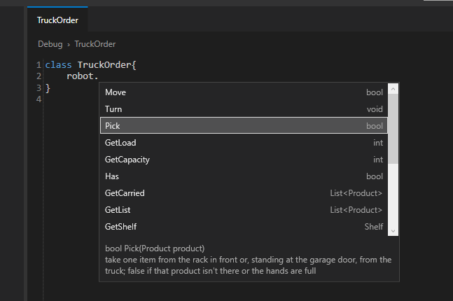
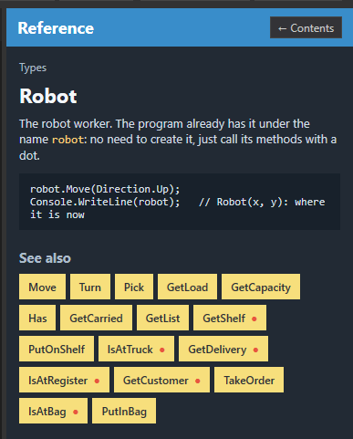

# CMIDE

CMIDE is a Windows code editor for [Code Market](https://store.steampowered.com/app/5451260/Code_Market/). Edit game scripts while your world is running, with completion and documentation that reflect your progress in the game.

Prefer VS Code? Try [Code Market Live for VS Code](https://github.com/CodeMarketModding/CMIDE-VSCode), which uses the same bridge.





Screenshots show an example document and reference entries.

**Upgrade-aware completion**



**Reference lookup** — Ctrl-click a supported symbol to open its in-game reference.



## Features

- Live two-way synchronization with the open game project, including protection against conflicting edits.
- C# and Java syntax highlighting and automatic, upgrade-aware completion. Use **Ctrl+Space** to request suggestions, **Tab** or **Enter** to insert, and **Esc** to dismiss.
- Automatic brace pairing and indentation when starting a new line inside a block.
- An Explorer for creating files and folders and renaming or deleting scripts.
- A searchable reference pane with unlocked in-game guides and API pages. Hold Ctrl over a supported symbol to highlight it, then click to open its reference.
- A Class Map for the current document, with clickable class and member declarations.
- Separate C# and Java reference stubs for local drafts. Local completions are not filtered by game upgrades.
- Local file editing without syncing those files to the game.

## Getting started

1. Install [CMIDE-Bridge](https://github.com/CodeMarketModding/CMIDE-Bridge/releases/latest) and BepInEx 5 in Code Market.
2. Download the Windows x64 ZIP from [Releases](https://github.com/CodeMarketModding/CMIDE/releases/latest) and extract it to a folder.
3. Start Code Market, load a world, then run `CodeMarket.IDE.exe` from the extracted folder. Select a script in the Explorer to edit it. Use the game's controls to run scripts.

The release includes the .NET runtime and does not require a separate .NET installation.

### Build from source

Install the [.NET 10 SDK](https://dotnet.microsoft.com/download/dotnet/10.0), clone the repository, and build:

```powershell
dotnet build IDE/CodeMarket.IDE.csproj -c Release -o IDE/builds/class-map
```

Run `Run IDE.cmd` from the repository after building.

The language of a game world is chosen in the game. Selecting another language in an open game script is a read-only preview; local drafts can be edited independently. The reference and game completions follow the connected world. Reconnect after switching worlds.

The updated game also offers other languages; CMIDE currently supports C# and Java worlds only and will explain if the selected world uses another language.

The Class Map is a lightweight outline of the current document; complex or incomplete declarations may not be detected. The bridge also hides folders starting with `_` from the game's script explorer while keeping them accessible in CMIDE.

The IDE and bridge communicate through local files in `%LOCALAPPDATA%\CodeMarketLiveIDE\bridge`. Running programs continue in the background while the IDE has focus; pause the game when needed.
